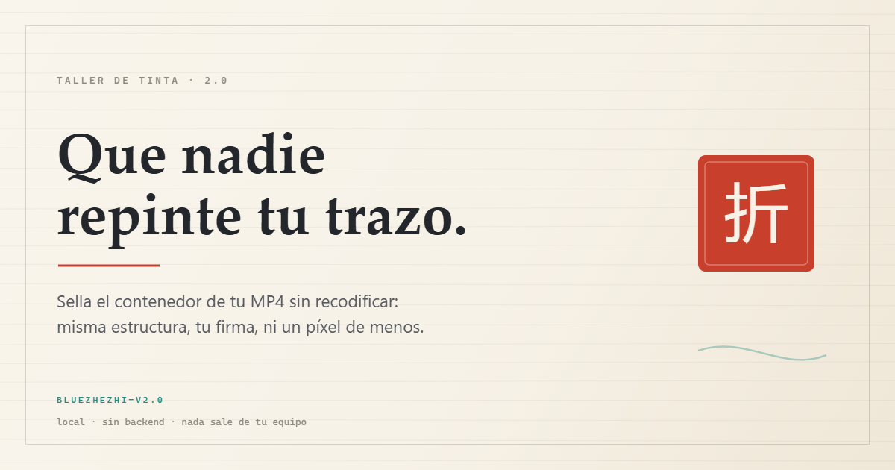

# Zhezhi 2.0 · taller de tinta

> La piel es de **Zhezhi** (折枝, *Wuthering Waves*): papel de jade blanco, tinta,
> malaquita, azurita y un bermellón para el sello. El motor reescribe el
> contenedor MP4 sin tocar el vídeo; lo que cambia dentro del archivo es la firma:
> **BlueZhezhi-v2.0**.

Utilidad **local** que reescribe el contenedor de un MP4 antes de subirlo a TikTok.
No recodifica si el vídeo ya es H.264/HEVC: trabaja a nivel de átomos (boxes), así
que el vídeo no pierde un solo píxel por el camino.

La metáfora es la de Zhezhi: nadie debería repintar un cuadro ajeno. La plataforma
tira del trazo para recomprimir y bajar la resolución; este taller reescribe el
contenedor con la misma estructura que el archivo de referencia y le pone su sello.

**En línea:** <https://blues-os.github.io/Zhezhi2Uploader/> ·
**En local:** `.\start.cmd` (sin conexión y sin backend).



> **Aviso honesto:** el sello deja el MP4 con la duración marcada como
> desconocida. Funciona hoy y con el archivo de referencia que se comparó, pero
> depende de cómo valide TikTok ese día: puede quedarse en «procesando» para
> siempre o ser rechazado. Si necesitas publicar con seguridad, desmarca la
> duración desconocida.

---

## Arrancar

Requisitos: Windows con PowerShell y un navegador Chromium/Firefox actualizado.
No hace falta Node, Python ni instalar nada.

```powershell
cd zhezhi-2.0
.\start.cmd
```

o manualmente:

```powershell
.\serve.ps1 -Port 5173
# abre http://localhost:5173
```

Si tienes la Zhezhi original abierta a la vez: `.\serve.ps1 -Port 5174`. Si el
puerto está ocupado: `.\serve.ps1 -Port 8080`.

El servidor solo sirve archivos estáticos de esta carpeta; no hay backend y el
vídeo nunca sale del navegador.

> La primera vez que uses un formato que no sea MP4 H.264, FFmpeg.wasm descarga
> ~32 MB desde unpkg. Se cachea en el navegador. Necesitas conexión para esa
> primera conversión; el parcheo directo funciona sin red.

---

## Cómo se usa

1. Arrastra un vídeo (MP4, MOV, MKV, WebM…) a la mesa.
2. Ajusta las dos casillas:
   - **Firmar la salida**: escribe la firma del taller en `udta/meta/ilst`, en los
     handlers y en el `compressor name`.
   - **Duración desconocida (mvhd)**: deja `mvhd` en versión 1 con
     `duration = 0xFFFFFFFFFFFFFFFF`.
3. Pulsa **Sellar el vídeo** y descarga el MP4.

El archivo de salida termina en `_zhezhi.mp4`.

### Firma en los metadatos

| Campo | Valor por defecto |
|---|---|
| `tagName` (`©too`, `©enc`, compressor name) | `BlueZhezhi-v2.0` |
| `tagComment` (`©ART`, `©nam`, `©wrt`, `©cmt`, `cprt`) | el mismo texto |
| handler de vídeo | el mismo texto |
| handler de audio | `SoundHandler` |
| sufijo de descarga | `_zhezhi.mp4` |

Desde la API los tres textos son independientes: `tagName`, `tagComment` y
`handlerName` (por defecto en el módulo: `BlueZhezhi-v2.0`, `BlueZhezhi` y
`BlueZhezhi-coded`).

---

## Qué hace exactamente

Es un parcheo del contenedor, ni más ni menos:

| Paso | Transformación |
|---|---|
| 1 | `mvhd` pasa a **versión 1** y su `duration` se escribe como `0xFFFFFFFFFFFFFFFF` (**duración desconocida**) |
| 2 | Se borran las `udta` del `moov` y de las pistas y se escribe `udta/meta/ilst` con `©ART`, `©nam`, `©too`, `©enc`, `©wrt`, `©cmt`, `cprt` |
| 3 | Handlers renombrados: vídeo → firma del taller, audio → `SoundHandler` |
| 4 | `compressor name` (32 bytes en el offset 50 de la entrada `stsd`) sobrescrito con la firma |
| 5 | Si el `moov` ya va antes del `mdat`, se recalculan todos los `stco`/`co64` (con paso a `co64` si hace falta) por el crecimiento del `moov` |

El resultado es un MP4 **válido** pero con firma de encoder ajena y duración
declarada como desconocida. No hay muestras fantasma ni tablas corruptas: eso es
la Zhezhi original, no este taller.

### Pipeline

```
archivo
  └─ ¿MP4 con vídeo H.264/HEVC y ≤ 120 fps?
       ├─ sí → patchMp4()          (sin pérdida, sin recodificar)
       └─ no → FFmpeg.wasm remux   (copia vídeo, AAC 192k)
                └─ si falla → FFmpeg.wasm transcode (libx264 CRF 20)
                     └─ patchMp4() sobre el resultado
  └─ verifyMp4()  (offsets dentro del mdat, mvhd desconocido, firma presente)
```

La primera conversión descarga ~32 MB de FFmpeg.wasm desde unpkg y se cachea.
El parcheo directo funciona sin red.

---

## Límites

- Memoria del navegador: por encima de ~300 MB puede fallar (entrada + salida
  + blob ≈ 3× el tamaño). No hay camino servidor: si es enorme, remuxea antes con
  ffmpeg de escritorio.
- Solo la primera pista de vídeo y la primera de audio.
- MP4 fragmentado (`moof`/`sidx`): se convierte primero con FFmpeg.
- Códecs aceptados sin recodificar: `avc1`, `avc3`, `hvc1`, `hev1`, `dvh1`,
  `dvhe`.
- No toca resolución, fps ni bitrate. No promete bitrate headroom ni color
  tagging.

---

## Prueba

`http://localhost:5173/test/test.html` construye un MP4 sintético en memoria
(sin vídeo real) y comprueba:

1. inspección del contenedor (códec, fps, duración, faststart),
2. sello por defecto: `mvhd` desconocido + firma + 100 offsets recalculados,
3. sin firma ni duración: salida idéntica a la entrada,
4. `moov` después de `mdat`: no toca offsets,
5. idempotencia (sellar dos veces no vuelve a crecer),
6. códec no parcheable → error,
7. más de 120 fps → error.

También hay `test/run.js` con el constructor del MP4 de prueba, reutilizable
desde la consola del navegador.

## Uso programático

```js
import { inspectMp4, patchMp4, verifyMp4 } from "./src/mp4.js";

const input = new Uint8Array(await file.arrayBuffer());
console.log(inspectMp4(input)); // { codec, width, height, fps, durationSec, ... }

const { bytes, report } = patchMp4(input, {
  sign: true,
  tagName: "BlueZhezhi-v2.0",
  handlerName: "BlueZhezhi-coded",
  markUnknownDuration: true,
});

const check = verifyMp4(bytes, {
  tagName: "BlueZhezhi-v2.0",
  expectUnknownDuration: true,
});
console.log(report, check.ok, check.issues);

const blob = new Blob([bytes], { type: "video/mp4" });
```

---

## Otras pieles del taller

| Piel | En línea | Firma en el MP4 |
|---|---|---|
| **Zhezhi** (original) | <https://blues-os.github.io/ZhezhiUploader/> | `BlueZhezhi-v2.0.3` |
| **Phrolova** | <https://blues-os.github.io/ZhezhiUploader/phrolova/> | `BluePhrolova-v2.0.3` |
| **Chisa** | <https://blues-os.github.io/BlueChisa/> | `BlueChisa` |
| **Chisa Uploader** (extensión) | <https://blues-os.github.io/ChisaUploader/> | — |
| **Zhezhi 2.0** | este repo | `BlueZhezhi-v2.0` |

---

## Aviso

Esto manipula metadatos a propósito para que la plataforma no trate el archivo
como un export estándar. Puede funcionar, puede quedarse en «procesando» o puede
rechazarse, y puede chocar con los términos de TikTok. Sin garantía.

No afiliado a Kuro Games, *Wuthering Waves* ni TikTok.
Zhezhi, Phrolova y *Wuthering Waves* son propiedad de Kuro Games; este proyecto
es un homenaje no oficial.

MIT.
